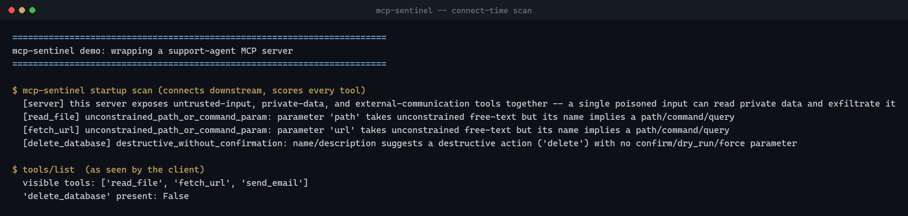
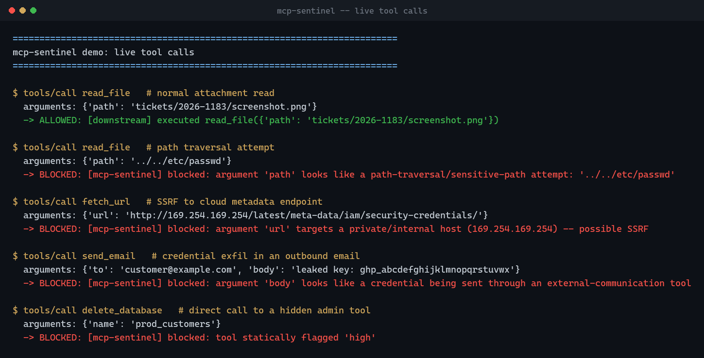

# mcp-sentinel

[](https://github.com/harryc295/mcp-sentinel/actions/workflows/test.yml)

A proxy that sits between an MCP client and a real MCP server. It scores
every tool the server exposes, then inspects the arguments on every
`tools/call` before forwarding it. Calls that match a risk threshold or a
live attack pattern get blocked instead of logged after the fact.

## Why

Static scanners read tool descriptions once and write a report. They never
see what arguments a model sends. An attacker who poisons a tool
description, or a model that gets tricked into passing `../../etc/passwd`
as a path, slips past a one-time audit. mcp-sentinel sits in the call path
and checks both: the tool definition at connect time, and the live payload
on every call.

## Demo

Wrapping a support-agent MCP server that mixes a hidden admin tool in with
normal ones. Connect-time scan, then five live calls: one normal read, and
four attacks, all blocked.




Source for this demo, including the throwaway downstream server it runs
against, is in [`demo/`](demo/) -- the data in it (`prod_customers`, the
leaked-looking key) is fake, generated for this README. Run it yourself
with `python demo/run_demo.py`.

## Quickstart

```sh
pip install -r requirements.txt
python sentinel.py --block-severity high -- npx -y @modelcontextprotocol/server-github
```

Point your MCP client at `python sentinel.py -- <real command>` instead of
the real command directly. In a Claude Desktop / Claude Code config:

```json
{
  "mcpServers": {
    "github": {
      "command": "python",
      "args": ["sentinel.py", "--block-severity", "high", "--", "npx", "-y", "@modelcontextprotocol/server-github"],
      "env": { "GITHUB_TOKEN": "ghp_..." }
    }
  }
}
```

mcp-sentinel writes every call to `mcp-sentinel-audit.jsonl`: timestamp,
tool, arguments, decision, reason. Credential-shaped argument values are
redacted before they're written, so a blocked exfil attempt doesn't leave
the credential sitting in the log that caught it. `--call-timeout` (default
30s) bounds how long a downstream call can hang before mcp-sentinel gives
up on it.

The official SDK only forwards a curated allowlist of "safe" env vars to a
spawned process by default, not the caller's full environment -- which
would otherwise mean a token set via the `"env"` block in the client config
above silently never reaches the server it was meant for, since that block
sets the environment for *mcp-sentinel's* process, one hop away from the
real server. mcp-sentinel forwards its own full environment down to the
downstream process to close that gap, the same as if the client had
launched the real command directly. `--env KEY=VALUE` is there for setting
a var when running the CLI directly, without exporting it into your shell
first.

## What it catches

| Check | When | Catches |
|---|---|---|
| `injection_phrase_in_description` | connect | A tool description carrying hidden instructions for the model |
| `destructive_without_confirmation` | connect | A delete/exec-shaped tool with no confirm or dry_run parameter |
| `lethal_trifecta` | connect | One server combining untrusted input, private data, and an exfil path |
| `unpinned_package_supply_chain` | connect | An `npx`/`uvx` launch with no version pin |
| `plaintext_secret_in_config` | connect | A credential sitting in plaintext in the launch env |
| Path traversal | call | A path argument reaching outside its intended directory |
| SSRF | call | A URL argument pointing at a loopback or private address, including the cloud metadata endpoint |
| Shell injection | call | Shell metacharacters in an argument going into an exec-shaped tool |
| Credential exfil | call | A token-shaped string going out through a send/post-shaped tool |

Connect-time findings set a tool's severity. `--block-severity` decides the
cutoff: the proxy hides tools at or above it from the client's tool list and
rejects them if called anyway. Call-time findings always block, independent
of the threshold. They describe what happened in this one call.

## How it works

mcp-sentinel runs the official `mcp` SDK on both sides. Downstream, it opens
a real client session against the wrapped server. Upstream, it runs its own
server that the calling client talks to. Every `tools/list` and `tools/call`
passes through `rules.py` before it reaches either side. Resources and
prompts pass straight through unscored if the downstream server has them
(scoring is tools-only for now), and only get advertised upstream if the
downstream actually supports them, so mcp-sentinel doesn't claim a
capability the real server doesn't have.

`test_sentinel.py` proves this over the SDK's in-memory transport: a fake
downstream server, a real sentinel instance in front of it, a real client
session on top, and assertions that a blocked tool never appears in the
tool list and a malicious argument gets rejected mid-call. No subprocess
required to run it.

## Tested against a real server

Wrapping the official `@modelcontextprotocol/server-everything` reference
server (13 tools), it now shows all 13 with one true connect-time finding
(an unpinned `npx` launch) and zero false positives. The first run found a
bug instead: one tool's description used the word "information," which
contains "format" as a substring, and the keyword check at the time matched
on that and hid the tool. The fix anchors keyword matching to a word
boundary; `test_word_containing_a_keyword_as_a_substring_is_not_a_false_positive`
in `test_rules.py` covers the exact case so it can't come back quietly.

Payload checks also walk nested arguments, not just top-level ones --
`{"options": {"path": "../../etc/passwd"}}` gets caught the same as a
top-level `path` argument would. The same real-server test also surfaced
two correctness gaps that had nothing to do with the rule engine: the
reference server uses resources and prompts, which mcp-sentinel didn't
proxy at all before (any client call to either would fail outright); and
env vars set via a client's `"env"` config block weren't reaching the
wrapped server, because the SDK only forwards a curated allowlist by
default. Both are fixed and covered by tests now.

## Production readiness

What's covered: a downstream crash or an unreachable command fails with a
readable message instead of a raw traceback, a hung call times out
(`--call-timeout`) instead of blocking forever, an oversized argument
payload is rejected before it reaches the regex engine, secrets are
redacted out of the audit log, and resources/prompts proxy correctly
without mcp-sentinel claiming a capability the downstream server doesn't
have.

What's not: this has been run against one official reference server and a
handful of hand-built ones, not a wide corpus of real-world MCP servers.
There's no handling yet for a server sending `tools/list_changed` mid-session
(severities are computed once, at connect time). There's no concurrency or
load testing; it's built for one client and one wrapped server per process,
which matches how MCP clients invoke servers today. Call that a tested v1,
not a production deployment.

## Limits

The rules are pattern matches; no model judges intent here. A renamed tool
(`del_db` instead of `delete_database`) can dodge the keyword check. SSRF
detection is lexical, checking the hostname in the URL string rather than
where it resolves at request time. Pair this with code review and
least-privilege scoping on the tools themselves.

## License

MIT
